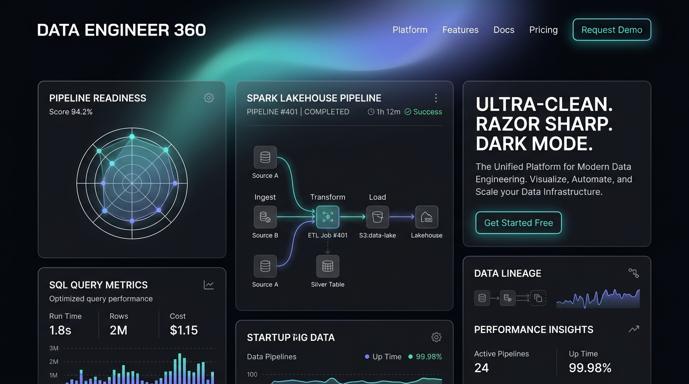
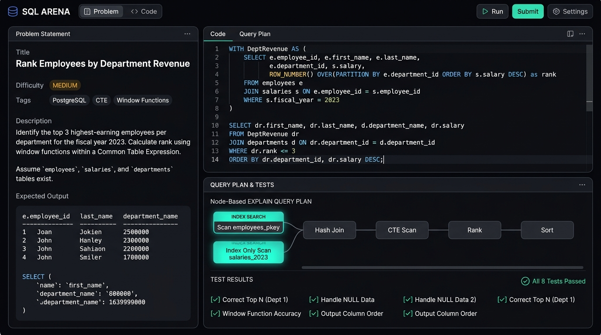
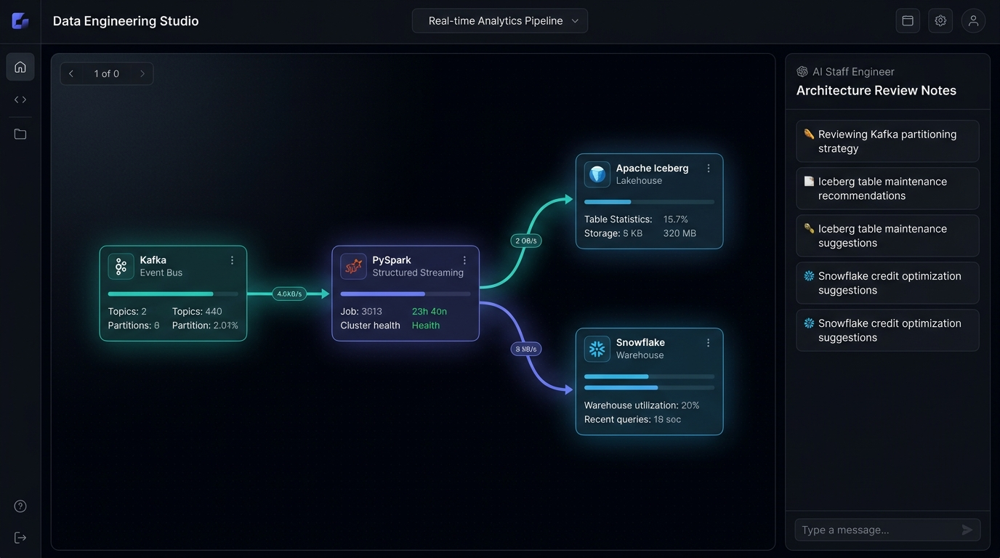
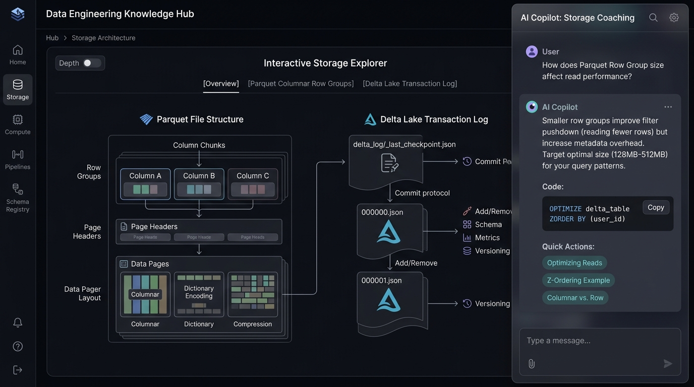
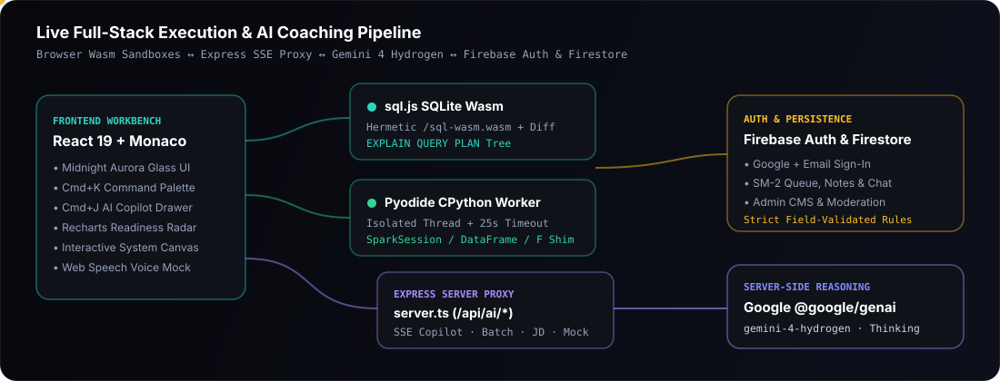
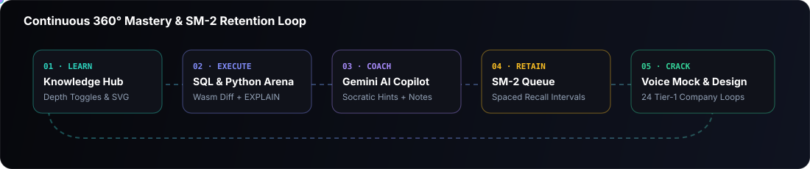
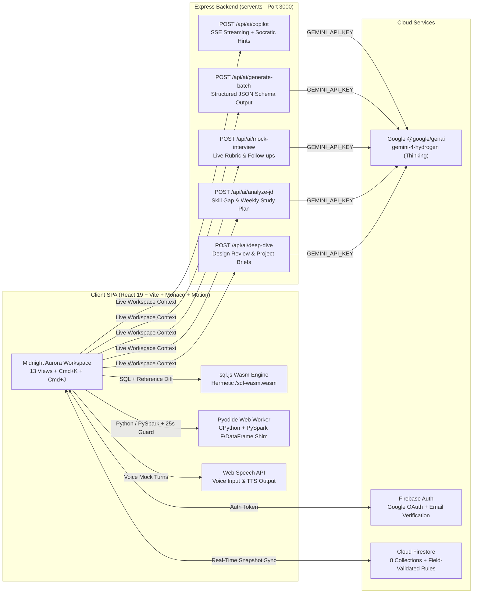
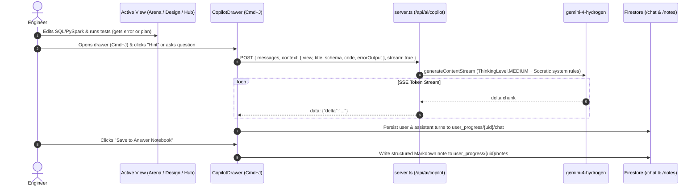

<div align="center">



<br />
<br />

[](https://react.dev/)
[](https://www.typescriptlang.org/)
[](https://tailwindcss.com/)
[](https://microsoft.github.io/monaco-editor/)
[](https://sql.js.org/)
[](https://pyodide.org/)
[](https://firebase.google.com/)
[](https://ai.google.dev/)

<p>
  <strong>Master Every Skill. Understand Every Concept. Crack Every Round.</strong><br />
  A full-stack Data Engineering Learning &amp; Tier-1 Interview Preparation Platform built for experienced engineers (3–4 yrs, 4–6 yrs, and 6+ yrs YOE).
</p>

[Platform Overview](#-platform-overview) •
[Visual Showcase](#-visual-showcase) •
[Architecture & Visualizations](#-architecture--visualizations) •
[Core Workspaces](#-core-workspaces--capabilities) •
[Design & Motion System](#-design--micro-interaction-system) •
[Quick Start](#-quick-start)

</div>


## ✨ Platform Overview

**D's platforms — DATA ENGINEER 360** unifies the best capabilities of **LeetCode**, **NeetCode**, **DataLemur**, **StrataScratch**, **DataVidhya**, **HackerRank**, **InterviewBit**, and interactive technical documentation into a single, cohesive dark-mode engineering workbench.

Designed specifically for **mid-to-staff Data Engineers (3–6+ YOE)** targeting **Tier-1 Global & Indian Product Companies**, the platform pairs **126 runnable launch seed labs** with real in-browser WebAssembly execution (`sql.js` + Pyodide CPython Worker), visual query-plan trees, SM-2 spaced repetition, interactive architecture canvases, Web Speech voice mock interviews, and a **live context-aware Gemini AI Copilot**.

### 🎯 Target Roles & Experience Calibration
Every roadmap, Knowledge Hub article, mock interview rubric, and readiness breakdown adapts to your selected seniority tier:

| Experience Tier | Primary Focus & Interview Bar |
| :--- | :--- |
| **3–4 yrs** *(DE I / DE II)* | Analytical SQL window functions, Python/DSA fundamentals, ETL idempotency, Airflow/dbt DAG patterns, star schema modeling. |
| **4–6 yrs** *(Senior DE / Analytics Engineer)* | Spark AQE & skew salting, Delta/Iceberg ACID internals, CDC watermarks, SARGable query plan tuning, multi-hop pipeline SLAs. |
| **6+ yrs** *(Staff / Principal / Cloud DE)* | Distributed consensus & multi-region LWW, Z-order/micro-partition clustering, streaming watermarks, FinOps cost governance, system design defense. |


## 📸 Visual Showcase

<div align="center">

### 1. Midnight Aurora Bento Command Center & Readiness Hub

<p><em>Frosted obsidian glass surfaces (<code>#07080C</code> / <code>#10121A</code>), Recharts competency radar, SM-2 review queue, streak tracking, and experience-tier calibration.</em></p>

<br />

### 2. SQL Arena with In-Browser SQLite Wasm & Visual `EXPLAIN QUERY PLAN` Tree

<p><em>Execute multi-CTE analytical SQL hermetically inside the browser via <code>/sql-wasm.wasm</code>, compare output tables cell-by-cell against reference queries, and inspect scan vs. index search nodes visually.</em></p>

<br />

### 3. Interactive System Design Studio & Staff Architecture Reviewer

<p><em>Compose Kafka, PySpark Structured Streaming, Apache Iceberg, and Snowflake pipelines on an interactive node canvas, then run server-side Gemini Staff Architect reviews for SPOFs, backpressure, and FinOps trade-offs.</em></p>

<br />

### 4. Interactive Knowledge Hub & Global Slide-Over Gemini AI Copilot (<code>Cmd+J</code>)

<p><em>3-column interactive documentation with depth toggles, SVG storage/lakehouse diagrams, 3D-flip flashcards, and an always-available SSE-streaming AI Copilot that sees your active code, schema, and errors.</em></p>

</div>


## 🏗 Architecture & Visualizations

### Live Full-Stack Execution & AI Coaching Pipeline (Animated)

<div align="center">
  
</div>

### Continuous 360° Mastery & SM-2 Spaced Repetition Loop (Animated)

<div align="center">
  
</div>

### End-to-End System Topology (`Mermaid`)



### Context-Aware AI Copilot Sequence (`Cmd+J`)




## 🚀 Core Workspaces & Capabilities

### 1. 📊 Readiness Hub & SM-2 Spaced Repetition Dashboard (`DashboardView`)
- **Bento Analytics Grid** built with `Recharts` (Domain Readiness Radar Chart, Track Progress Bars, Difficulty Split, Study Hours & Daily Streak KPIs).
- **SM-2 Spaced Repetition Queue**: Rate solved items (`Again`, `Hard`, `Good`, `Easy`) to automatically compute `easeFactor`, `repetitions`, and `nextReviewAt` intervals.
- **Calibration Notice**: Readiness percentages are explicitly framed as estimated preparation benchmarks across practiced skills rather than hiring guarantees.

### 2. 🗺️ Curated Study Roadmaps & 1-Click AI Practice Batch (`RoadmapsView` & `GenerateBatchButton`)
- **126 Launch Seed Runnable Problems** organized across 3 core tracks (**42 Analytical SQL + 42 Python & DSA + 42 DE Core / PySpark / Labs**):
  1. **Analytical SQL Mastery (42 problems)**: `ROW_NUMBER`/`RANK`/`DENSE_RANK`, Gaps & Islands, Sessionization, Rolling & Moving Aggregations, Funnel Conversion, Cohort Retention, Point-in-Time FX/Feature Joins, Recursive CTEs, Date Spines, SARGability & Query Optimization.
  2. **DSA Pattern Roadmap (42 problems)**: Arrays & Hashing, Two Pointers, Sliding Window, Monotonic Stack, Binary Search, Linked Lists, Trees, Tries, Heaps, Graphs/Topological Sort, Dynamic Programming, Intervals — framed for Python DE interviews.
  3. **Data Engineering Core & PySpark Labs (42 problems)**: Skew Key Salting, SCD Type 1/2/3 Merge, Iceberg Bin-Packing Compaction, Spark AQE Partition Coalescing, 2D Z-Order Morton Encoding, Kafka Consumer Lag, Watermark Late-Event Filtering, CDC Tombstone Compaction, Parquet RLE/Dictionary Encoding, dbt AST Refs, Write-Audit-Publish (WAP) Quarantine, and FinOps Auto-Suspend Estimators.
- **One-Click "Generate Practice Batch" (5 or 10 Questions)**: Synthesizes fresh runnable SQL, Python/DSA, or PySpark practice questions on demand via Gemini structured JSON schemas, strictly tagged `ai_generated_practice` (`AI-Generated Practice`) and persisted to Firestore.

### 3. 🗄️ SQL Arena & Visual `EXPLAIN QUERY PLAN` Inspector (`SqlArenaView` & `sqlEngine.ts`)
- Runs completely offline/hermetically in-browser using **`sql.js`** (`public/sql-wasm.wasm`).
- Executes your SQL against isolated schema/DDL fixtures, runs the canonical reference SQL in a second clean DB instance, and performs **exact row/column/cell normalization diffing**.
- Parses SQLite `EXPLAIN QUERY PLAN` output into a color-coded **Visual Execution Plan Tree** (`SCAN`, `SEARCH`, `INDEX`, `TEMP_BTREE`, `SUBQUERY`) with automated performance warnings for full table scans and temporary B-Tree sorts.

### 4. 🐍 Python, DSA & PySpark Engineering Labs (`PythonArenaView` & `pythonEngine.ts`)
- Dedicated **Web Worker** hosting **Pyodide CPython (`v0.27.2`)** with a 25-second infinite-loop termination watchdog.
- Built-in **`PYSPARK_SHIM`** supporting `SparkSession.builder.appName().getOrCreate()`, `createDataFrame()`, `Row`, `DataFrame` (`select`, `filter`, `where`, `withColumn`, `count`, `show`, `collect`, `toPandas`), and `F.col()` / `F.lit()`.
- Runs multi-assertion test suites and streams `stdout`, `stderr`, and per-test pass/fail diagnostics.

### 5. 📚 3-Column Interactive Knowledge Hub (`KnowledgeHubView`)
- Deep-dive Tier-1 syllabus modules covering Query Engines, Storage Internals (Parquet/Delta/Iceberg), Distributed Spark & Skew Tuning, Data Modeling (Kimball/SCDs/OBT), and Streaming/Kafka internals.
- Features **Experience Depth Toggles** (`3–4 yrs`, `4–6 yrs`, `6+ yrs`), **`LEARN` / `PRACTISE` / `INTERVIEW` tabs**, **interactive SVG architecture diagrams**, **3D CSS-perspective flip flashcards**, **topic quizzes**, and 1-click export to your Answer Notebook.

### 6. 🏢 24 Tier-1 Company Portals & Moderated Experiences (`CompanyHubsView`)
- Dedicated company interview portals for **24 Global & Indian Product Leaders**:
  `Google` · `Databricks` · `Uber` · `Snowflake` · `Netflix` · `Meta` · `Amazon` · `Airbnb` · `LinkedIn` · `Microsoft` · `Stripe` · `Apple` · `Confluent` · `Adobe` · `Salesforce` · `Atlassian` · `PhonePe` · `Flipkart` · `Swiggy` · `Zomato` · `Razorpay` · `Meesho` · `Intuit` · `Walmart Global Tech`.
- View typical round loops, weighted focus areas, filtered runnable questions, and community-submitted interview experiences (with verification status badges: `verified`, `reported_experience`, `pending_review`).

### 7. 🧩 System Design Studio, Incident Labs & Project Deep Dive (`SystemDesignStudioView`)
- **System Design Studio**: Interactive node-and-connector architecture board for designing lakehouse, streaming, and warehouse pipelines + on-demand **Staff Engineer AI Architecture Review**.
- **Production Incident Labs**: Real-world production troubleshooting simulations (skewed executors, Kafka consumer lag spikes, SCD-2 overlapping intervals, OOMs, small-file explosions).
- **Project Deep Dive Generator**: Input your own project's stack, scale metrics, and architecture notes to generate a 90-second executive pitch, trade-off defenses, failure-mode talking points, and 6 hard follow-up Q&As.

### 8. 🎙️ AI Mock & Voice Interviewer + 🎯 JD Analyser + 📓 Answer Notebook
- **AI Mock & Voice Interviewer (`MockInterviewView`)**: Conduct realistic company- and round-specific technical interviews using **Web Speech API** (`SpeechRecognition` + `speechSynthesis`) or text, complete with live rubric scores, strengths, gaps probed, and end-of-round debriefs.
- **JD Analyser (`JdAnalyzerView`)**: Paste any Data Engineering Job Description to extract prioritized skills, severity-ranked gap analysis, recommended platform tracks, and a week-by-week preparation plan.
- **Personal Answer Notebook (`NotebookView`)**: Save AI Copilot explanations, Knowledge Hub notes, or custom interview scripts in Firestore and **export everything to clean Markdown (`.md`)** anytime.

### 9. 🛡️ Admin CMS (`/admin` · `AdminCmsView`)
- Accessible at `/admin` for verified administrators (`divyaraj8861@gmail.com` or UIDs registered in `/admins/{uid}`).
- Full **CRUD Question Bank Manager** (add, search, inline edit, delete), **Bulk JSON & CSV Importer** (chunked in 400-doc Firestore batches for 3,700+ question scaling), **Duplicate Title Auditor**, and **Interview Experience Moderation Queue**.


## 🎨 Design & Micro-Interaction System

**D's platforms — DATA ENGINEER 360** follows the **"Midnight Aurora & Editorial Obsidian"** design language inspired by Linear, Raycast, Arc, and Vercel:

| Token / Element | Value / Specification | Purpose |
| :--- | :--- | :--- |
| **Canvas Base** | `#07080C` | Deep Velvet Obsidian primary background with ambient top radial aurora mesh |
| **Frosted Glass Cards** | `#10121A` (`80%` opacity + `backdrop-blur-xl`) | Crisp `1px solid rgba(255,255,255,0.08)` borders & specular top edge |
| **Primary Aurora Gradient** | `#2DD4BF` (Luminous Teal) → `#818CF8` (Soft Indigo) | Primary CTAs, brand monogram, active states |
| **Semantic Status Colors** | `#34D399` (Emerald) · `#FBBF24` (Gold) · `#FB7185` (Rose) · `#A78BFA` (Iris) | Passing assertions, streaks/Medium, Hard problems, Gemini AI Copilot |
| **Typography** | `Plus Jakarta Sans` · `DM Sans` · `JetBrains Mono` (`tabular-nums`) | Geometric headings, crisp editorial body, aligned code & SQL metrics |
| **Animations** | Framer Motion (`motion/react`) + CSS 3D Flip + SMIL SVG | Fluid `AnimatePresence` drawers, modal spring physics, 3D flashcard flips |
| **Global Shortcuts** | `Cmd/Ctrl + K` (Command Palette) · `Cmd/Ctrl + J` (AI Copilot) | Zero-friction keyboard navigation across all 126+ labs, topics, & companies |


## 🧰 Tech Stack & Repository Structure

### Dependencies
- **Frontend**: `react` (`^19.0.1`), `react-dom`, `typescript`, `vite` (`^8.3.0`), `@tailwindcss/vite` (`^4.3.3`), `motion` (`^12.23.24`), `lucide-react`, `recharts` (`^3.10.1`), `react-markdown`, `remark-gfm`, `@monaco-editor/react` (`^4.7.0`)
- **In-Browser Runtimes**: `sql.js` (`^1.16.0` + `/public/sql-wasm.wasm`), Pyodide WebAssembly Worker (`v0.27.2`)
- **Backend & AI**: `express` (`^4.21.2`), `tsx` (`^4.21.0`), `@google/genai` (`^3.3.0`, model `gemini-4-hydrogen`), `dotenv`
- **Auth & Database**: `firebase` (`^13.3.0`) — Firebase Auth (Google + Email/Password) + Cloud Firestore

### Directory Layout

```text
.
├── docs/
│   └── svg/                        # Animated SMIL SVGs for GitHub README
├── public/
│   └── sql-wasm.wasm               # Hermetic SQLite WebAssembly binary (673 KB)
├── src/
│   ├── assets/images/              # Platform UI showcase visuals
│   ├── components/
│   │   ├── AdminCmsView.tsx        # /admin CRUD, bulk JSON/CSV importer, moderation
│   │   ├── AuthModal.tsx           # Google Sign-In + Email auth & verification
│   │   ├── BrandMark.tsx           # Bespoke D' aurora gradient SVG monogram
│   │   ├── CommandPalette.tsx      # Global Cmd+K quick switcher
│   │   ├── CompanyHubsView.tsx     # 24 Tier-1 Company Portals + experiences
│   │   ├── CopilotDrawer.tsx       # Global Cmd+J SSE AI Copilot slide-over
│   │   ├── DashboardView.tsx       # Readiness Radar, KPIs, & SM-2 queue
│   │   ├── GenerateBatchButton.tsx # 1-click 5/10 AI Practice Batch generator
│   │   ├── JdAnalyzerView.tsx      # JD skill extractor & gap roadmap
│   │   ├── KnowledgeHubView.tsx    # 3-col docs, SVG diagrams, 3D flashcards, quiz
│   │   ├── MockInterviewView.tsx   # Web Speech API AI Voice & Text Mock
│   │   ├── NotebookView.tsx        # Answer Notebook + Markdown (.md) export
│   │   ├── PythonArenaView.tsx     # Python/DSA & PySpark/Labs Monaco Arena
│   │   ├── RoadmapsView.tsx        # 3 curated study roadmaps & pattern filters
│   │   ├── SqlArenaView.tsx        # SQL Arena + Visual EXPLAIN Query Plan Tree
│   │   └── SystemDesignStudioView.tsx # Architecture canvas, Incident Labs, Deep Dive
│   ├── data/
│   │   ├── seedSqlQuestions.ts     # 42 verified SQLite Wasm analytical problems
│   │   ├── seedDsaPythonQuestions.ts # 42 verified Python/DSA problems
│   │   ├── seedDeCoreQuestions.ts  # 42 verified PySpark, Iceberg, & DE Labs
│   │   ├── seedKnowledge.ts        # Interactive Knowledge Hub modules & quizzes
│   │   ├── seedCompanies.ts        # 24 Tier-1 Company Portals & experiences
│   │   └── seedScenarios.ts        # Production troubleshooting incident scenarios
│   ├── lib/
│   │   ├── firebase.ts             # Firebase app init & Firestore error helpers
│   │   ├── firestoreService.ts     # SM-2 math, chunked batching, real-time hooks
│   │   ├── sqlEngine.ts            # sql.js runner, diffing, & EXPLAIN parser
│   │   └── pythonEngine.ts         # Pyodide Web Worker + PySpark DataFrame shim
│   ├── types/
│   │   ├── platform.ts             # Domain types across all 13 workspaces
│   │   └── sqljs.d.ts              # TypeScript declarations for sql.js
│   ├── App.tsx                     # Root workspace shell, sidebar, routing, sync
│   └── index.css                   # Midnight Aurora Tailwind v4 theme & 3D flip CSS
├── firebase-applet-config.json     # Provisioned Firebase client config
├── firebase-blueprint.json         # Firestore entity schema blueprint
├── firestore.rules                 # Strict field-validated Firestore security rules
├── server.ts                       # Express + Vite middleware + /api/ai/* routes
├── metadata.json                   # App metadata & microphone permission
└── package.json                    # Scripts & dependencies
```


## 🔌 Server API & Firestore Schema

### Server-Side Gemini Endpoints (`/server.ts`)
All Gemini API calls execute strictly server-side using `process.env.GEMINI_API_KEY`:

| Method & Endpoint | Capability |
| :--- | :--- |
| `GET /api/health` | Service health check (`{ ok: true, service: "data-engineer-360" }`). |
| `POST /api/ai/copilot` | Context-aware AI coaching via **Server-Sent Events (SSE)** (`coach`, `hint`, `debug`, `explain_plan`, `solution` modes). |
| `POST /api/ai/generate-batch` | Generates 5 or 10 structured, runnable practice questions tagged `ai_generated_practice`. |
| `POST /api/ai/mock-interview` | Multi-turn technical mock interview evaluator returning follow-ups, rubric scores, strengths, & gaps. |
| `POST /api/ai/analyze-jd` | Parses pasted job descriptions into skill priorities, gap severity, and week-by-week plans. |
| `POST /api/ai/deep-dive` | Produces Staff Architect System Design reviews and Project Deep Dive interview briefs. |

### Firestore Collections (`firestore.rules`)
- `/users/{userId}` — Private user profile, target roles/companies, streak, experience tier.
- `/user_progress/{userId}` — Solved/attempted IDs, bookmarks, completed topics, SM-2 queue.
  - `/notes/{noteId}` — Personal Answer Notebook entries.
  - `/submissions/{submissionId}` — SQL/Python/PySpark execution history.
  - `/chat/{messageId}` — Persisted AI Copilot conversation history.
- `/questions/{questionId}` — Public curriculum extensions, admin CMS entries, and AI-generated practice batches.
- `/knowledge_topics/{topicId}` — Knowledge Hub topic overrides/additions.
- `/interview_experiences/{expId}` — Community interview reports with moderation workflow (`pending_review` → `verified` / `reported_experience` / `rejected`).


## ⚡ Quick Start

### 1. Prerequisites
- **Node.js `v22+`** (supports native TypeScript stripping for production `node server.ts`)
- A **Gemini API Key** (`GEMINI_API_KEY`) configured in your environment or `.env`
- Provisioned Firebase config in `firebase-applet-config.json` (Authentication: Google + Email/Password enabled)

### 2. Install & Run Development Server
```bash
npm install
npm run dev
```
The full-stack Express + Vite server launches on **`http://localhost:3000`**.

### 3. Build, Type-Check & Production Start
```bash
# TypeScript static verification
npm run lint

# Build production client bundle into /dist
npm run build

# Start production Express server serving /dist + /api/ai/*
NODE_ENV=production npm start
```

### 4. Environment Variables (`.env.example`)
```env
GEMINI_API_KEY="YOUR_GEMINI_API_KEY"
APP_URL="http://localhost:3000"
```

<div align="center">
  <br />
  
  <p>
    Built for Data Engineers · <strong>D's platforms — DATA ENGINEER 360</strong><br />
    <em>"Master Every Skill. Understand Every Concept. Crack Every Round."</em>
  </p>
</div>
